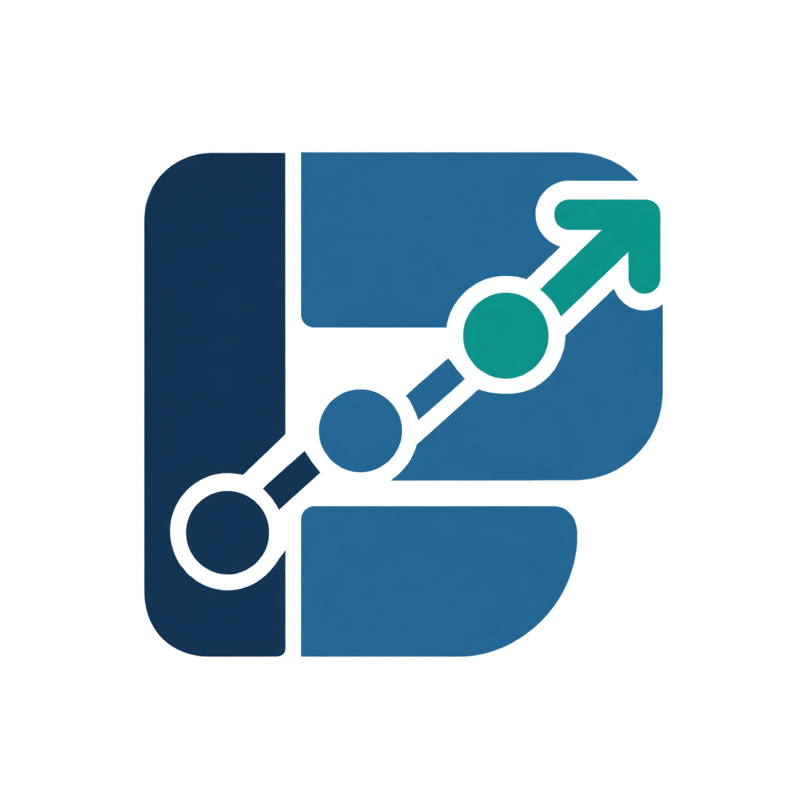
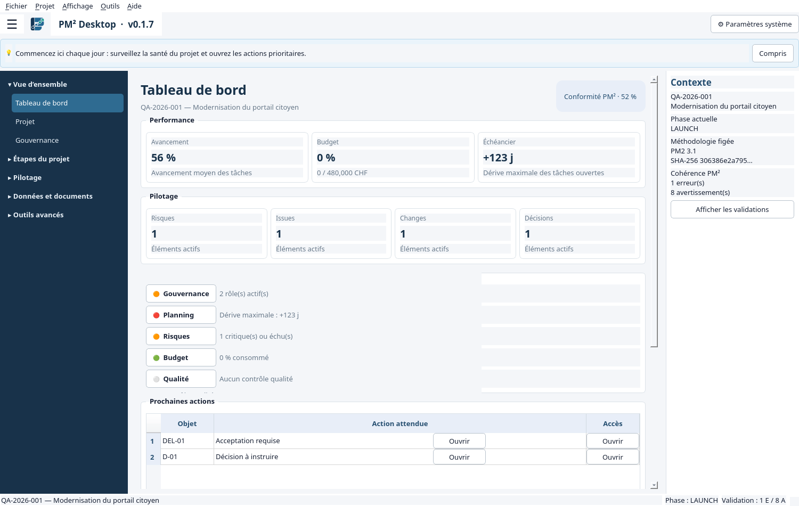
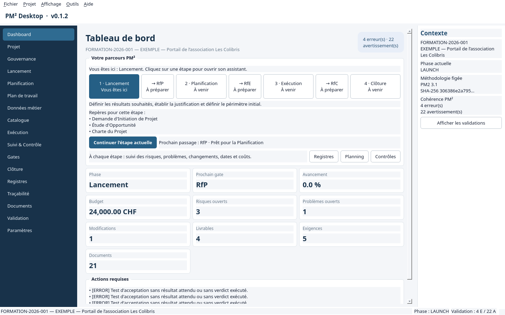

<p align="center">
  
</p>

# 🧭 PM² Desktop 0.1.8

**Pilotez vos projets PM², du lancement à la clôture, dans une application locale en français.**

[](https://github.com/nouhailler/Pm2or/releases/tag/v0.1.8)


PM² Desktop est une application de gestion de projets locale, en français, fondée sur la méthodologie PM² v3.1 de la Commission européenne. Elle utilise PySide6/Qt6, SQLAlchemy 2 et SQLite et ne requiert aucun serveur ni accès Internet à l'exécution.

Le code est distribué sous la [European Union Public Licence 1.2](LICENSE).

**[📦 Télécharger le .deb](https://github.com/nouhailler/Pm2or/releases/download/v0.1.8/pm2-desktop_0.1.8_amd64.deb)** · **[📖 Guide utilisateur](docs/GUIDE_UTILISATEUR.md)** · **[📝 Notes de version](docs/RELEASE_0.1.8.md)**



> 💡 **Conçu pour être pris en main sans formation préalable.** Le menu `☰`
> regroupe les fonctions par métier, l'aide contextuelle présente chaque écran et
> les infobulles expliquent les champs et les actions.

## ✨ Fonctions disponibles

- infobulles explicatives et accessibles sur les menus, boutons, onglets, champs,
  listes et tableaux, y compris dans les fenêtres créées dynamiquement ;
- onboarding initial avec mentions légales, guide contextuel à la première visite de
  chaque écran et possibilité de revoir le parcours depuis le menu **Aide** ;
- fiches détaillées accessibles par double-clic ou touche Entrée sur toutes les lignes de
  tableaux, avec une présentation enrichie pour les documents et artefacts ;
- menu hamburger et navigation par cinq catégories repliables : Vue d’ensemble,
  Étapes du projet, Pilotage, Données et documents, Outils avancés ;
- paramètres système indiquant la version, sa date de sortie et la dernière vérification,
  avec contrôle manuel ou périodique des nouvelles versions ;
- glossaire et mini-encyclopédie hors ligne avec recherche, comparaison de 12 approches,
  chronologie historique, guide de choix et sources officielles ;
- cockpit projet quotidien : avancement, consommation budgétaire, dérive d'échéance,
  registres actifs, santé par domaine et prochaines actions cliquables ;
- parcours graphique sur le tableau de bord : position réelle du projet, phases cliquables,
  revues de passage et raccourcis vers les assistants, registres, planning et contrôles ;
- assistants complets Lancement, Planification, Exécution et Clôture avec complétude,
  validations, données sources, artefacts, gates, acceptations et fermeture administrative ;
- gates RfP, RfE et RfC avec checklists issues de la configuration méthodologique ;
- gouvernance, personnes, rôles PM², parties prenantes et matrice RCmSCI ;
- WBS arborescente avec déplacement, réordonnancement, indentation/désindentation,
  archivage, tâches, jalons, dates, effort, coût et avancement ;
- moteur de planning CPM avec dépendances FS/SS/FF/SF, lag/lead, dates au plus
  tôt et au plus tard, marge totale et chemins critiques ;
- gestion des personnes, équipes, fournisseurs, équipements et ressources
  budgétaires avec disponibilités hebdomadaires, allocations aux tâches et
  alertes de surcharge ;
- graphe de traçabilité navigable couvrant exigences, tâches, livrables,
  acceptation, risques, mitigations et impacts, avec détection des orphelins ;
- registres des risques, problèmes, décisions et modifications avec workflows contrôlés ;
- qualité, transition, mise en œuvre organisationnelle et réunions ;
- Centre de conformité PM² avec scores par phase, readiness des gates et corrections guidées ;
- catalogue détaillé des 52 entités avec CRUD, relations, validation et audit ;
- pièces jointes intégrées au projet, contrôlées par SHA-256 et conservées dans la base ;
- exécution des tests d'acceptation et acceptation finale contrôlée depuis l'interface ;
- 21 artefacts spécialisés, avec saisie structurée, aperçu, versions et exports Markdown,
  HTML, DOCX et PDF ;
- sauvegarde et réouverture d'archives `.pm2` avec contrôle d'intégrité.

## 📥 Installation Debian

Téléchargez le paquet **Debian 13 amd64** dans les [releases GitHub](https://github.com/nouhailler/Pm2or/releases), puis exécutez :

```bash
sudo apt install ./pm2-desktop_0.1.8_amd64.deb
pm2-desktop
```

Un lanceur avec icône est installé dans le menu des applications. Python est embarqué dans le paquet.

Le bouton **Installer l'application**, disponible sur l'accueil et dans les paramètres
système, crée également un raccourci avec le logo dans le menu du bureau Linux. Cette
version est une application desktop ; aucun paquet Android ou iOS signé n'est fourni à
ce stade.

> ℹ️ Le paquet nécessite glibc 2.41 ou ultérieure. La compatibilité avec Debian 12 et Ubuntu 24.04 n’est pas assurée.

Pour vérifier le téléchargement, placez le [fichier SHA256SUMS-0.1.8](https://github.com/nouhailler/Pm2or/releases/download/v0.1.8/SHA256SUMS-0.1.8) à côté du `.deb` :

```bash
sha256sum -c SHA256SUMS-0.1.8
```

### 🔄 Mises à jour

Les **Paramètres système** affichent la date de sortie et la date de la dernière
vérification. La recherche de mises à jour s'effectue en arrière-plan à intervalle
régulier et peut être désactivée. Elle contacte uniquement l'API des releases GitHub ;
les données des projets ne sont jamais envoyées.

L'installation automatique est un choix explicite de l'utilisateur. Le paquet Debian
n'est lancé qu'après vérification de l'empreinte SHA-256 publiée par GitHub, puis Linux
peut demander une autorisation administrateur via sa boîte de dialogue système. En
l'absence d'empreinte, l'installation automatique est refusée.

## 🛠️ Installation développeur

Python 3.12 ou supérieur et [uv](https://docs.astral.sh/uv/) sont requis.

```bash
git clone https://github.com/nouhailler/Pm2or.git
cd Pm2or
uv sync --frozen --extra dev
```

Sous Windows, remplacez `.venv/bin/` par `.venv\Scripts\`.

## ▶️ Lancement

```bash
.venv/bin/pm2-desktop
```

Une base particulière peut être ouverte avec :

```bash
.venv/bin/pm2-desktop --database /chemin/vers/projet.db
```

Le diagnostic sans interface vérifie la base et la méthodologie :

```bash
.venv/bin/pm2-desktop --headless-check
```

Un rapport de support anonymisé peut être écrit sans ouvrir l'interface :

```bash
.venv/bin/pm2-desktop --diagnostics diagnostic.json
```



### 🧭 Tester le parcours graphique

Ouvrez un projet puis sélectionnez **Vue d’ensemble → Tableau de bord**. Le cockpit présente immédiatement l'avancement, la consommation du budget, la dérive d'échéance, les éléments actifs, la santé du projet et les actions prioritaires. Les indicateurs de santé et les actions ouvrent directement la section à traiter.

Le bloc **Votre parcours PM²** indique
« Vous êtes ici ». Cliquez sur une phase pour ouvrir son assistant ou sur
**Continuer l’étape actuelle** pour reprendre le travail. Ces clics naviguent dans
l’application ; les changements de phase passent par une décision de revue.

Un [projet fictif d’entraînement](examples/portail-association.pm2) et son
[parcours d’exercices](examples/EXERCICES.md) sont fournis. Pour repartir du cas initial,
utilisez **Fichier → Ouvrir un projet…** et sélectionnez cette archive.

### 🎓 Projet d'entraînement

Le cas **Les Colibris** est aujourd’hui un support d’entraînement : il commence en
lancement, avec un planning proposé, des documents en brouillon et des tests à exécuter.
Il peut être enrichi pour devenir un projet de démonstration complet avec des données
réalistes, des décisions et des preuves d'acceptation. Le point de reprise courant est
consigné dans [CONTEXT.md](CONTEXT.md) et l'historique dans
[CHANGELOG.md](CHANGELOG.md).

### 💾 Stockage local

Les données applicatives sont conservées par défaut dans `~/.local/share/pm2-desktop`. La variable `PM2_DATA_DIR` permet de choisir un autre dossier. Les mises à niveau du schéma créent automatiquement une copie `.pre-migration-*.bak` de toute base existante avant modification.

## 🧪 Tests et contrôles

La branche courante est validée avec **158 tests automatisés** et **82,70 % de
couverture**, ainsi que Ruff, mypy sur toutes les couches et un audit des
dépendances d'exécution. La suite couvre les parcours Qt du
[plan de test](10_TEST_PLAN.md), un cycle de vie complet, les migrations, les
archives et leurs fichiers annexes, les pièces jointes, le diagnostic anonymisé,
le moteur CPM, les scénarios de gel méthodologique, les infobulles et les fiches
détaillées des tableaux.

```bash
QT_QPA_PLATFORM=offscreen .venv/bin/pytest --cov=pm2 --cov-report=term-missing
.venv/bin/ruff check src tests scripts
.venv/bin/mypy src/pm2
```

La couverture de lignes et de branches ne peut pas descendre sous **80 %** ; le niveau
mesuré sur la branche courante est de **82,70 %**.

## 🏗️ Construction des paquets

```bash
./scripts/build.sh

# Assembler le paquet Debian à partir du bundle PyInstaller
.venv/bin/python scripts/package_deb.py
```

Le script exécute les contrôles puis construit `dist/pm2-desktop` avec PyInstaller. Consultez [le guide utilisateur](docs/GUIDE_UTILISATEUR.md) et [le guide développeur](docs/GUIDE_DEVELOPPEUR.md) pour la suite.

## 🔒 Méthodologie figée par projet

Le fichier `04_PM2_METHODOLOGY.yaml` est la source de vérité pour les phases, rôles, activités, artefacts, gates, responsabilités et règles PM² de la V0.1. Les widgets Qt ne définissent aucune règle méthodologique et toutes les transitions sont contrôlées par les services applicatifs.

Chaque nouveau projet fige l’identifiant, la version, un snapshot YAML canonique complet et son SHA-256. À la réouverture, les écrans utilisent exclusivement ce snapshot, et non le YAML installé. En cas d’écart, l’interface propose de conserver la méthodologie, examiner les différences ou effectuer une mise à niveau explicite et auditée.

Les archives `.pm2` (format 1.2, avec lecture des formats 1.0 et 1.1) embarquent `methodology/PM2_METHODOLOGY.yaml`. Le manifeste vérifie la cohérence avec SQLite ainsi que la taille et le SHA-256 de chaque document, pièce jointe et export. Les anciens projets sans snapshot ne peuvent être complétés automatiquement que si leur identifiant et leur version correspondent à ceux de la méthodologie installée ; le contenu historique exact ne peut pas être reconstitué a posteriori.

## 📏 Baselines immuables

La page **Baselines** fige l’état du projet — budget, Work Plan, jalons, exigences, livrables, risques, documents et données des artefacts — dans un snapshot JSON signé par SHA-256. Une référence `B-001`, `B-002`, etc. ne peut être ni modifiée ni supprimée. Son approbation est nominative et définitive. L’application compare ensuite cette référence à l’état courant et détaille les ajouts, retraits et modifications. Voir [le contrat des baselines](docs/BASELINES_IMMUABLES.md).

## 🕰️ Audit Trail

La page **Audit Trail** présente la chronologie du projet avec date, utilisateur, origine, objet, action et raison. Chaque événement permet d'examiner les valeurs **Avant** et **Après** champ par champ. Le journal, append-only et protégé contre la modification ou la suppression, est filtrable et exportable en JSON pour contrôle ou diagnostic.

## ✅ Centre de conformité PM²

La page **Conformité PM²** calcule un score global et une progression par phase, puis présente la readiness des gates RfP, RfE et RfC à partir de leurs contrôles obligatoires. Les écarts identiques sont regroupés, filtrables par sévérité et associés à une action corrective cliquable qui ouvre directement la section métier concernée. Le bouton **Recalculer** actualise immédiatement les scores après correction.

```text
projet.pm2
├── manifest.json
├── methodology/
│   └── PM2_METHODOLOGY.yaml
├── project.db
├── documents/
├── attachments/
└── exports/
```

## 📚 Documentation

| Ressource | Contenu |
| :--- | :--- |
| [📖 Guide utilisateur](docs/GUIDE_UTILISATEUR.md) | Prise en main de l’application |
| [🔧 Guide développeur](docs/GUIDE_DEVELOPPEUR.md) | Environnement et développement |
| [🏛️ Architecture](01_ARCHITECTURE.md) | Organisation et couches applicatives |
| [🗃️ Schéma de données](03_DATABASE_SCHEMA.md) | Tables, contraintes et migrations |
| [🔒 Méthodologie figée](docs/METHODOLOGIE_FIGEE.md) | Snapshots, intégrité et mises à niveau |
| [📏 Baselines immuables](docs/BASELINES_IMMUABLES.md) | Références approuvées et calcul des écarts |
| [📚 Glossaire & encyclopédie](docs/GLOSSAIRE_ENCYCLOPEDIE.md) | Notions, méthodes, histoire et guide de choix |
| [🧪 Plan de test](10_TEST_PLAN.md) | Scénarios de validation |
| [👁️ Recette visuelle V0.1](docs/RECETTE_VISUELLE_V0.1.md) | Contrôles des écrans |
| [📝 Notes de version 0.1.8](docs/RELEASE_0.1.8.md) | Nouveautés et installation |
| [Contexte et reprise](CONTEXT.md) | État du projet et prochain chantier |
| [Historique des changements](CHANGELOG.md) | Versions publiées et travaux à venir |
